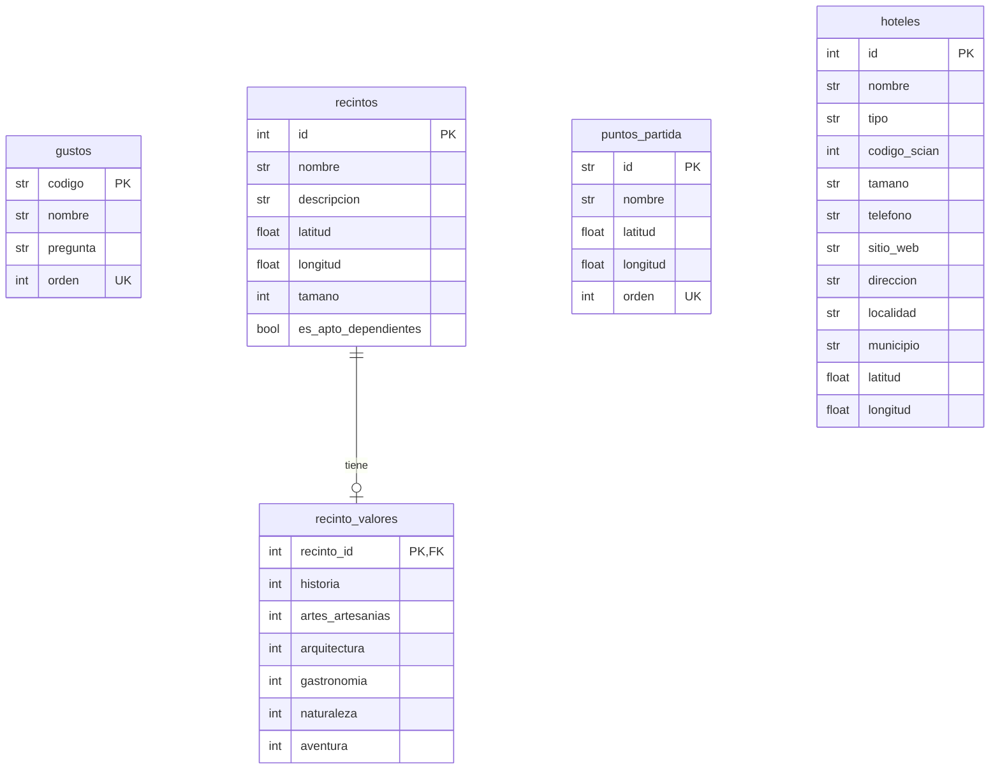

# Base de datos
En progreso.

Guarda el catálogo de gustos, los recintos y cuánto ofrece cada recinto de cada gusto. Con esos valores el backend calcula las afinidades que usa el modelo de interés.

## Diagrama

## Diccionario de datos

### gustos
Catálogo de preguntas para enviarselo al front y que lo muestre.

| Columna | Tipo | Para qué sirve | Cómo se puebla |
|---|---|---|---|
| `codigo` | texto, PK | Identifica el gusto, como `historia` | Llenado manual. |
| `nombre` | texto | Nombre que se muestra al turista | Llenado manual. |
| `pregunta` | texto | Pregunta con la que el turista califica el gusto del 1 al 5 | Llenado manual. |
| `orden` | entero, único | Posición en la que se muestra | Llenado manual. |

### recintos
Datos especificos del recitno. Se cargan por la API: POST /recintos para darlos de alta y PATCH /recintos/{id} para corregirlos.

| Columna | Tipo | Para qué sirve | Cómo se puebla |
|---|---|---|---|
| `id` | entero, PK autoincremental | Identifica el recinto. La API lo muestra como clave: 1 es `R0001` | Lo asigna la base al crear el recinto y nunca reutiliza el número de uno borrado. |
| `nombre` | texto | Nombre que se muestra | Manual |
| `descripcion` | texto, opcional | Ficha corta del recinto | Manual. |
| `latitud` | decimal, -90 a 90 | Ubicación del recinto | Manual |
| `longitud` | decimal, -180 a 180 | Ubicación del recinto | Manual |
| `tamano` | entero, 1 a 3 | 1 chico, 2 mediano, 3 grande. Lo usa el modelo de minutos | Manual, se determina a ojo. |
| `es_apto_dependientes` | booleano, por defecto 1 | Si el recinto es adecuado para niñas, niños o personas mayores. Los que no lo son se ocultan a quien viaja con ellos | Manual. Si no se envía, vale 1. |

### recinto_valores
Valores para comparar con los gustos que ingrese la persona. Se envían junto con el recinto en POST /recintos y se reemplazan con PUT /recintos/{id}/valores.

| Columna | Tipo | Para qué sirve | Cómo se puebla |
|---|---|---|---|
| `recinto_id` | entero, PK y FK | Recinto al que pertenecen los valores. Si se borra el recinto, se borran sus valores | El `id` del recinto |
| `historia` … `aventura` | entero, 0 a 3 | Cuánto ofrece el recinto de cada gusto: 0 nada, 1 secundario, 2 importante, 3 razón principal | Manual, determinado a ojo e investigación. |

### puntos_partida
Ciudades desde las que sale el turista. No se visitan ni se recomiendan, solo sirven como catalogo para iniciar la ruta.

| Columna | Tipo | Para qué sirve | Cómo se puebla |
|---|---|---|---|
| `id` | texto, PK | Identifica el punto, como `morelia`. Es la misma clave que usa el frontend | Migración, igual que en el frontend. |
| `nombre` | texto | Nombre que se muestra | Migración. |
| `latitud` | decimal, -90 a 90 | Ubicación de salida | Migración: punto medio entre el centro y la central de autobuses (OpenStreetMap). |
| `longitud` | decimal, -180 a 180 | Ubicación de salida | Migración: punto medio entre el centro y la central de autobuses (OpenStreetMap). |
| `orden` | entero, único | Posición en la que se muestra | Migración. |

### hoteles
Establecimientos de hospedaje de Michoacán tomados del DENUE de INEGI (hoteles, moteles, cabañas, casas de huéspedes, departamentos amueblados y campamentos). No se relacionan con otras tablas pues se buscan por cercanía a la última parada de cada día. El índice `ix_hoteles_latitud_longitud` permite filtrar primero por un recuadro de coordenadas.

| Columna | Tipo | Para qué sirve | Cómo se puebla |
|---|---|---|---|
| `id` | entero, PK | Identifica el establecimiento. Es el `id` del DENUE, no uno propio, para poder recargar una edición nueva sin duplicar | `data_science/datos/procesados/hoteles.csv` |
| `nombre` | texto | Nombre que se muestra | DENUE, de mayúsculas a mayúsculas iniciales |
| `tipo` | texto | Hotel, Motel, Cabañas, Casa de huéspedes, Departamento amueblado o Campamento | Derivado de `codigo_scian` |
| `codigo_scian` | entero | Actividad económica del SCIAN, como 721112 (hoteles sin otros servicios integrados) | DENUE |
| `tamano` | texto: micro, pequena, mediana o grande | Tamaño por personal ocupado (micro 0 a 10, pequeña 11 a 50, mediana 51 a 100, grande 101 o más). Sirve para dar prioridad a los negocios pequeños | Derivado del rango de personal del DENUE |
| `telefono` | texto, opcional | 10 dígitos. Se guarda como texto para no perder ceros ni convertirlo en número | DENUE |
| `sitio_web` | texto, opcional | Con `https://` | DENUE |
| `direccion` | texto, opcional | Calle, número y colonia, como "Calle Ponce de León 12, Centro" | Armada a partir de las columnas del DENUE |
| `localidad` | texto | Localidad donde está | DENUE |
| `municipio` | texto | Municipio donde está | DENUE |
| `latitud` | decimal, -90 a 90 | Ubicación | DENUE |
| `longitud` | decimal, -180 a 180 | Ubicación | DENUE |
