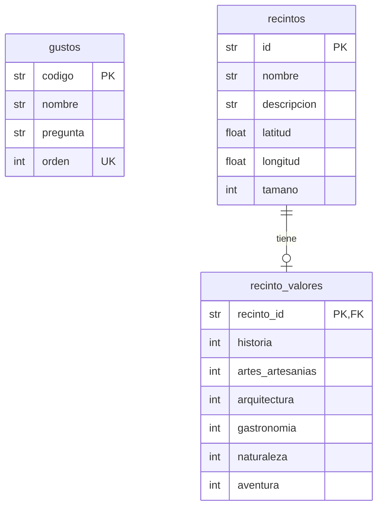

# Base de datos
En progreso.

Guarda el catálogo de gustos, los recintos y cuánto ofrece cada recinto de cada gusto. Con esos valores el backend calcula las afinidades que usa el modelo de interés.

## Diagrama

## Diccionario de datos

### gustos
Catálogo de preguntas para enviarselo al front y que lo muestre.

| Columna | Tipo | Para qué sirve | Cómo se puebla |
|---|---|---|---|
| `codigo` | texto, PK | Identifica el gusto, como `historia` | Llenado manual. |
| `nombre` | texto | Nombre que se muestra al turista | Llenado manual. |
| `pregunta` | texto | Pregunta con la que el turista califica el gusto del 1 al 5 | Llenado manual. |
| `orden` | entero, único | Posición en la que se muestra | Llenado manual. |

### recintos
Datos especificos del recitno.

| Columna | Tipo | Para qué sirve | Cómo se puebla |
|---|---|---|---|
| `id` | texto, PK | Identifica el recinto, como `tzintzuntzan` | El mismo `recinto_id`. |
| `nombre` | texto | Nombre que se muestra | Manual |
| `descripcion` | texto, opcional | Ficha corta del recinto | Manual. |
| `latitud` | decimal, -90 a 90 | Ubicación del recinto | Manual |
| `longitud` | decimal, -180 a 180 | Ubicación del recinto | Manual |
| `tamano` | entero, 1 a 3 | 1 chico, 2 mediano, 3 grande. Lo usa el modelo de minutos | Manual, se determina a ojo. |

### recinto_valores
Valores para comparar con los gustos que ingrese la persona.

| Columna | Tipo | Para qué sirve | Cómo se puebla |
|---|---|---|---|
| `recinto_id` | texto, PK y FK | Recinto al que pertenecen los valores. Si se borra el recinto, se borran sus valores | El `id` del recinto |
| `historia` … `aventura` | entero, 0 a 3 | Cuánto ofrece el recinto de cada gusto: 0 nada, 1 secundario, 2 importante, 3 razón principal | Manual, determinado a ojo e investigación. |
